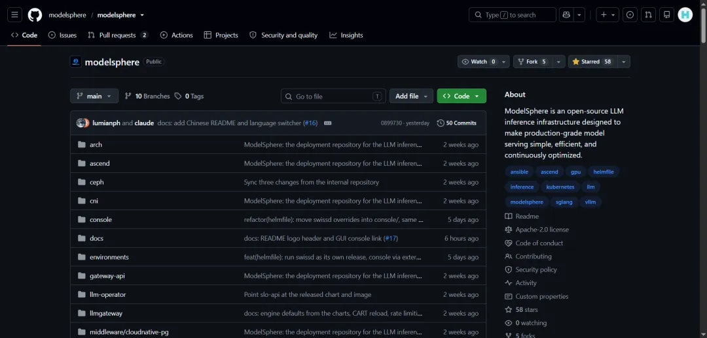
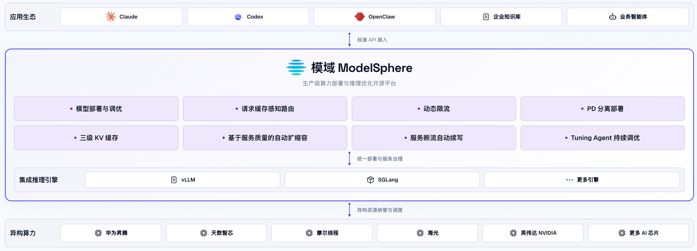
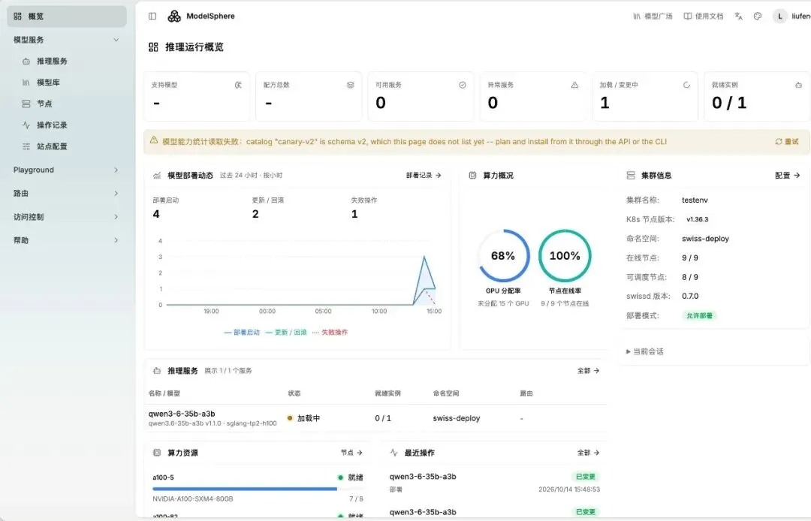
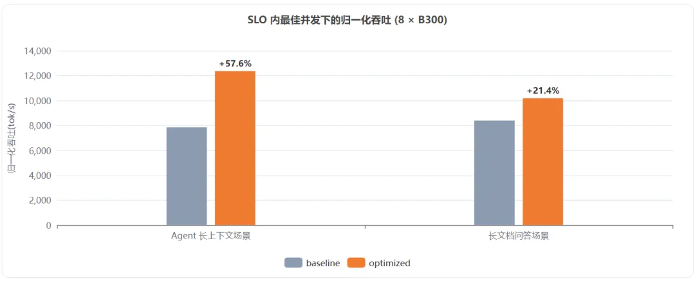
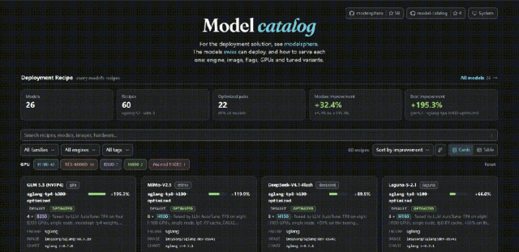

## 从演示环境走进生产

演示环境里，一张卡、一个引擎、一条 `curl`，常常就够看了。可流量一进生产，事情就变成另一张清单：异构芯片要适配，Kubernetes 要搭，路由、限流、扩缩容要接上，节点挂了还得尽可能接着吐字。很多团队卡在这里——模型能答，服务却很难稳着值班。

vLLM、SGLang 已经把单机吞吐往前推了一大截，可生产要的不只是发动机更快，还包括整支车队在高峰里能否跑稳、跑省。真正耗人的，往往是引擎之外的调度与治理。

模域 ModelSphere 因此开源。它是一个面向生产级大模型推理的开源基础设施平台，基于 Kubernetes，把模型部署、缓存感知路由、按 SLO 的弹性伸缩、可观测性、断流续写，以及面向真实负载探索配置的 Tuning Agent，整合到一套服务栈中。

## 我们是谁

模域 ModelSphere 想让企业和开发者少从零搭，把原始算力变成更安全、稳定、可运营的模型服务。我们的目标是：算力进厂，服务出厂；中间的装配、调度、扩缩容、监控告警，尽量交给平台。

推理引擎继续负责单实例的计算效率；模域负责集群层面的部署与治理。两者配合，让模型服务在集群里管得住、扩得动，并在支持的场景下从中断处继续生成。



源码与快速上手：[modelsphere/modelsphere](https://github.com/modelsphere/modelsphere)。

## 我们在做什么

### 从单实例手动配置，到集群自动统筹

如果把 vLLM、SGLang 比作高性能发动机，模域 ModelSphere 就是车队调度与管理系统，让引擎上车、组队、投产。

传统上，上生产意味着大量手工活：适配芯片驱动、搭建 Kubernetes、接入流量网关、编写扩缩容脚本。模域希望将这些工作沉淀为可以复用的自动化能力：

- **集群统筹**：在单实例计算之外，通过请求路由与弹性扩缩容管理多节点集群，响应并发变化。
- **异构资源管理**：在 NVIDIA GPU、华为昇腾、天数智芯等算力环境中提供统一的服务栈。具体芯片、驱动、模型和引擎组合，仍需按部署配方与环境要求核对。
- **服务治理**：将服务质量、故障恢复与观测信号接入部署和运行流程，减少服务层组件的重复建设。



### 一套平台，服务不同团队

- **平台与基础设施团队**：统一管理多模型部署、请求路由与运行策略，减少重复搭建服务层组件的工作。
- **业务与算法研发团队**：通过模型目录、可视化配置和标准化服务入口，把更多精力投入模型优化与业务应用。
- **运维与 SRE 团队**：结合健康检测、服务指标、优雅排空、限流与伸缩机制，处理流量变化和日常运维。

## 我们的优势是什么

### 将部署与服务治理放到同一条链路

在准备好 Kubernetes 集群、`kubectl`、Helm、Helmfile 和 `helm-diff`，并按[快速开始文档](https://github.com/modelsphere/modelsphere/blob/d5c892d2c1747b9411b423dae5c776d0c84a8003/README.zh-CN.md#快速开始)配置和注册 `mycluster` 环境后，可以通过以下命令安装服务栈：

```bash
make helm-apply ENV=mycluster
```

模型部署是后续的独立步骤，可通过 Helm 配方或图形化控制平台完成。实际安装时间取决于集群、网络、镜像和模型准备情况。

平台将弹性扩缩容、Prefill/Decode 分离、分层 KV 缓存、基于服务质量的动态限流等能力纳入同一套部署与治理流程。断流续写则在[续写网关支持的请求及模型、引擎组合](https://github.com/modelsphere/continuation_gateway)中，将已经生成的内容作为前缀发起续写；具体能力按对应组件的配置与限制启用。



### 用真实负载持续探索更优配置

ModelSphere 的[负载驱动自动调优目前为预览版](https://github.com/modelsphere/llm-autotune)。Tuning Agent 利用真实负载探索服务配置，在吞吐量、首字响应时间等约束下寻找更合适的参数组合。

以 **B300 + Kimi K3（mxfp4）** 为例，公开测试报告在 **TTFT p50 ≤ 8,000 ms、每请求生成速度 ≥ 15 tok/s** 的 SLO 约束下，对比基线配方与优化配置，并分别取满足 SLO 时的最佳并发点。按 8 卡归一化的吞吐量如下：

| 工作负载                               |    基线配置 |     优化配置 |  提升 |
| -------------------------------------- | ----------: | -----------: | ----: |
| Agent 长上下文（50k 输入 + 1.5k 输出） | 7,850 tok/s | 12,368 tok/s | 57.6% |
| Document QA（8k 输入 + 1k 输出）       | 8,394 tok/s | 10,189 tok/s | 21.4% |



以上结果对应报告中的特定硬件、精度、引擎配置和工作负载，不代表所有部署的通用收益。[完整测试报告](https://github.com/modelsphere/model-catalog/blob/5b668ff2bfd5459ff01d3be6e26cdeac1b037f60/models/kimi-k3/kimi-k3-1.0.4-b300-report.html)保留了配置、并发扫描与指标记录，可用于进一步核对比较口径。

### 在统一服务栈中管理异构算力

企业的算力资源往往来自不同硬件厂商。模域通过统一的 Kubernetes 服务栈和部署配置，将异构加速器纳入服务管理流程，减少在每类环境中重新搭建外围系统的工作。

硬件接入仍需匹配对应驱动、设备插件、推理引擎与模型配置。部署前，应核对目标环境的安装指南及配方，而不是把统一纳管理解为所有硬件组合都无需适配。

### 持续跟进模型与推理引擎

模型和引擎持续演进，部署经验也需要不断更新。[模型目录](https://modelsphere.github.io/model-catalog/)集中提供包括 DeepSeek、Qwen、Kimi、MiniMax、GLM 等家族在内的模型与部署配方，供用户按硬件、引擎和场景选择。

配方、版本与测试结果共同构成部署依据。新模型的接入与优化进展，以目录中的具体记录为准。



## 加入我们

ModelSphere 的初衷，是把系统工程上的积累，沉淀成可以分叉、审查、共建的公共资产。一次提交、一次调优，不只服务某一家团队，也能帮助更多使用者。

欢迎开发者、企业用户、硬件厂商和生态伙伴参与：

- 按[源码仓库的快速开始](https://github.com/modelsphere/modelsphere)跑一次最小安装。
- 提交 [Issue](https://github.com/modelsphere/modelsphere/issues)，写清环境、芯片、模型和报错原文。
- 分享真实负载下的调优案例，提出异构适配建议，或通过 PR 贡献改进。
- 如果项目对你有帮助，欢迎在 GitHub 上点一个 Star。

更多信息见 [ModelSphere 官网](https://modelsphere.tech/)。
